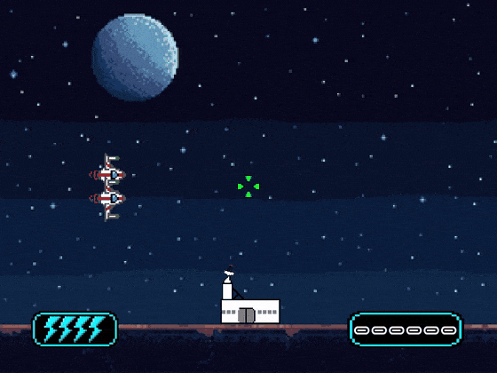
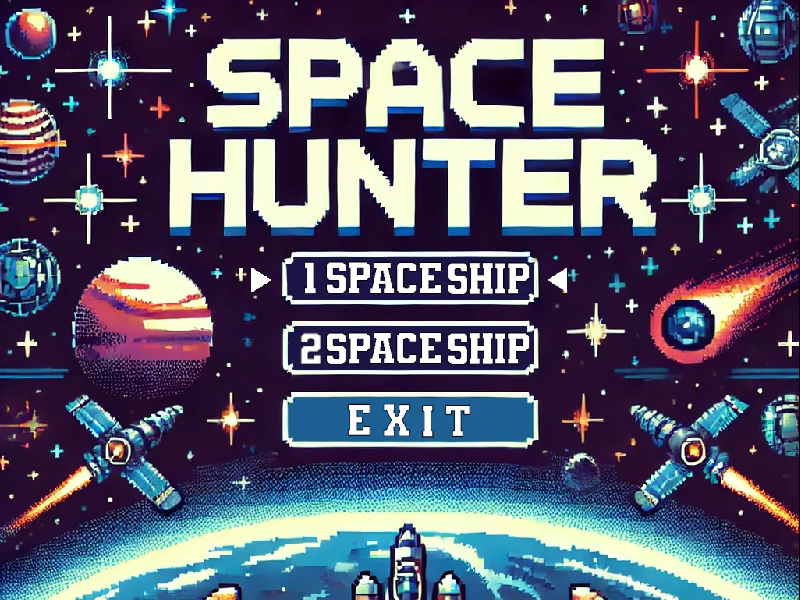
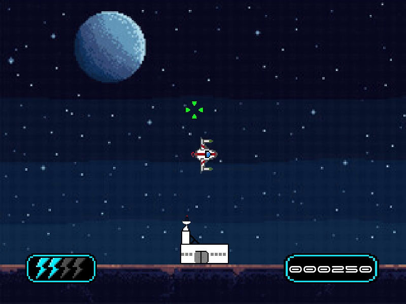

# Space Hunter

The "space_hunter" project is an application developed in C language, using CSFML, aimed at reproducing the "Duck Hunt" games in a space style.

<p align="center">
  
</p>

<p align="center">
  🎬 <a href="assets/demo.mp4"><b>Watch the full presentation video (25s)</b></a>
</p>

## Table of Contents

- [Description](#description)
- [Screenshots](#screenshots)
- [Installation](#installation)
- [Usage](#usage)

## Description

Your objective is to save your base from the alien invader, by destroying the enemy's spaceships, while clicking on them.
You can fight one or two enemies, according to your choices.

!!! Be careful, your enemies gain speed over time !!!

GOOD LUCK TO YOU.

## Screenshots

| Main menu | In game |
|:---------:|:-------:|
|  |  |

## Installation

### Installation Steps

1. Clone the repository :

   ```bash
   git clone https://github.com/ZeHack0/my_hunter-space_hunter.git
   ```

2. Navigate to the project directory :

   ```bash
   cd my_hunter-space_hunter
   ```

3. Compile the project :

   - **With Docker** (recommended, no need to install the CSFML) :

     ```bash
     make docker
     ```

     This builds a Docker image with the CSFML and creates the `./space_hunter` launcher.

   - **Natively** (if the CSFML is already installed) :

     ```bash
     make
     ```

### Docker prerequisites

| OS | Needed |
|----|--------|
| Linux | Docker. The window opens on your X11 / XWayland session, sound goes through PulseAudio / PipeWire. |
| macOS | Docker (Docker Desktop or OrbStack) + [XQuartz](https://www.xquartz.org/) : `brew install --cask xquartz`, then log out / log back in once. Optional sound : `brew install pulseaudio`. |
| Windows | Docker Desktop + WSL2 : run the commands from the WSL terminal (WSLg handles the window and the sound). |

## Usage

### How to use

- Run the application :

   ```bash
   ./space_hunter
   ```

- Run the explanation of the project :

   ```bash
   ./space_hunter -h
   ```

### Controls

| Key | Action |
|-----|--------|
| `↑` / `↓` | Navigate the main menu |
| `Enter` | Select a mode (1 or 2 spaceships) |
| Left click | Shoot — a hit costs no energy, a miss uses one charge of your laser magazine |
| Close the window | Quit the game |
